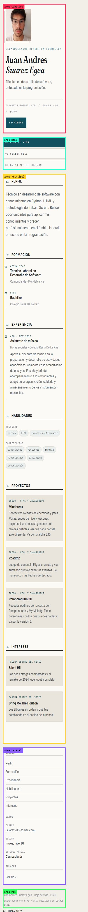
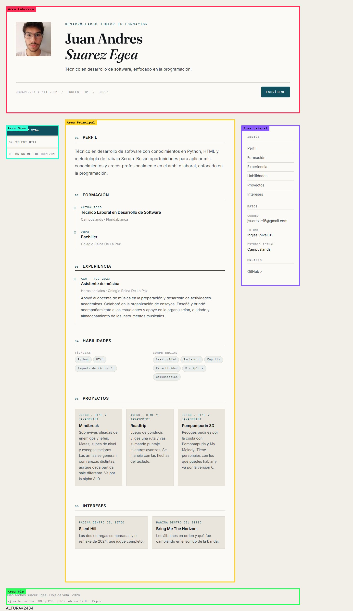
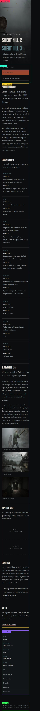
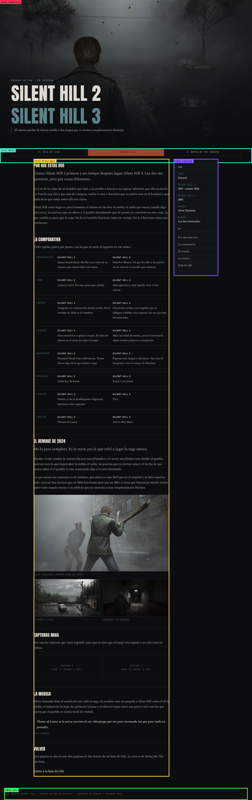
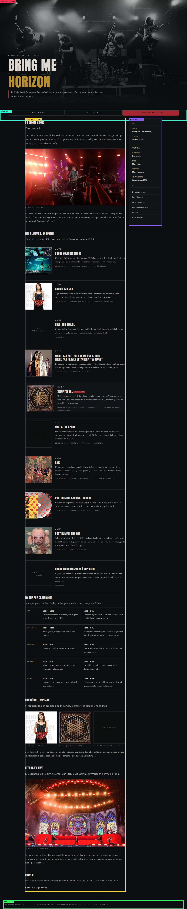
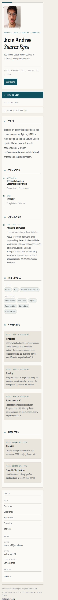
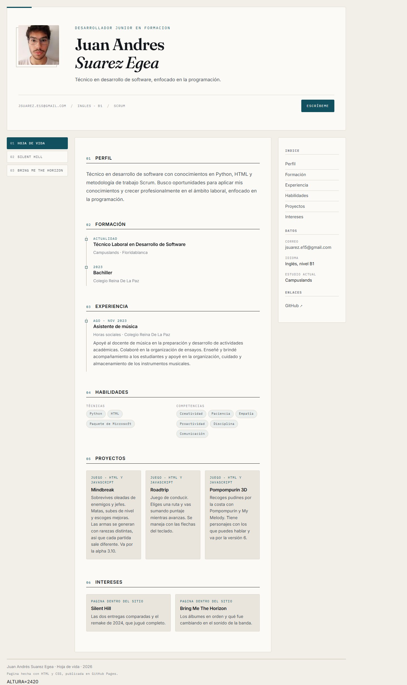
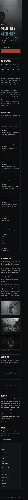
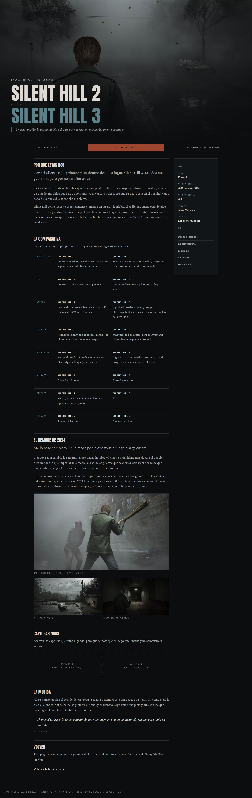
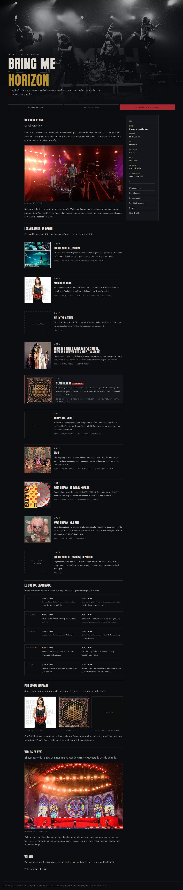

# Hoja de vida web — Juan Andrés Suarez Egea

Sitio personal con mi hoja de vida y mis dos páginas de fan (Silent Hill y Bring Me The Horizon). Está hecho solo con HTML y CSS, con una única hoja de estilos para las tres páginas y diseño adaptable de celular a computador.

**Sitio publicado:** https://juan-1522.github.io/hoja-de-vida-html/

**Repositorio:** https://github.com/Juan-1522/hoja-de-vida-html

## Páginas

- `index.html` — hoja de vida: perfil, formación, experiencia, proyectos, habilidades e intereses.
- `silent-hill.html` — página de fan sobre Silent Hill.
- `bring-me-the-horizon.html` — página de fan sobre Bring Me The Horizon: la discografía en orden, cómo cambió su sonido y por dónde empezar.

Las tres comparten el mismo menú de navegación y el mismo archivo `styles.css`.

## Mockups

Diseño de cada página vista en celular y en computador. Las zonas de color marcadas en cada imagen muestran las áreas del Grid (`cabecera`, `menú`, `principal`, `lateral`, `pie`) para que se vea cómo se reordena el contenido según el ancho.

### Hoja de vida

### Silent Hill

### Bring Me The Horizon

## Capturas del sitio publicado

Vista real de cada página en los dos extremos del diseño: 390px de ancho (celular) y 1440px (computador).

> Falta reemplazar al menos una de estas por una captura tomada en un celular real, como pide la actividad.

## Breakpoints

El CSS está escrito de arriba hacia abajo: primero lo del celular y después las pantallas más grandes.

- **Base (menos de 640px, celular):** una sola columna. En la hoja de vida las áreas del Grid apiladas en orden `cabecera → menú → principal → lateral → pie`; el menú es vertical, los álbumes de la página de fan muestran la carátula arriba y el texto debajo, y las galerías van en una columna.
- **Desde 640px (tableta):** el menú pasa de vertical a horizontal, el título principal crece, la fila de la ficha compara los dos lados en columnas (`7rem 1fr 1fr`), cada álbum se pone en dos columnas (`11rem 1fr`, carátula al lado del texto) y la galería de tres carátulas se muestra de a tres.
- **Desde 1080px (computador):** el sitio usa el Grid completo con `grid-template-areas` en tres columnas (`18% 1fr 20%`), el menú queda fijo a la izquierda (`position: sticky`) y las tarjetas se repiten solas con `repeat(auto-fit, minmax(12rem, 1fr))`. En las páginas de fan la portada ocupa casi toda la pantalla (`74vh`), aparece la columna lateral pegajosa y las galerías pasan a dos columnas, con las figuras `.ancha` ocupando todo el ancho.

## Cómo lo publiqué

1. Abrí la carpeta del proyecto en el editor (Visual) y desde ahí creé el repositorio `hoja-de-vida-html`.
2. Puse el remote con la dirección de GitHub y desde el panel de Control de fuentes hice los commits y el primer push a la rama `main`.
3. En GitHub entré a **Settings → Pages**, elegí la rama `main` y la carpeta `/(root)` y guardé.
4. GitHub generó la dirección `https://juan-1522.github.io/hoja-de-vida-html/` y ahí quedó publicado.
5. Revisé los enlaces y las imágenes desde el sitio publicado y corregí las rutas que apuntaban a archivos que no existían.

## Fuentes consultadas

- [MDN — Grid layout](https://developer.mozilla.org/es/docs/Web/CSS/CSS_grid_layout) para `grid-template-areas` y `repeat(auto-fit, minmax())`.
- [MDN — Media queries](https://developer.mozilla.org/es/docs/Web/CSS/CSS_media_queries/Using_media_queries) para el enfoque *mobile first*.
- [W3C Markup Validation Service](https://validator.w3.org/) para validar el HTML.
- [Google Fonts](https://fonts.google.com/) para las tipografías del sitio.
- Discografía y fechas de Bring Me The Horizon: [Wikipedia](https://en.wikipedia.org/wiki/Bring_Me_the_Horizon_discography).
- Fotografía de la banda y carátules de los álbumes: [Wikimedia Commons](https://commons.wikimedia.org/).
